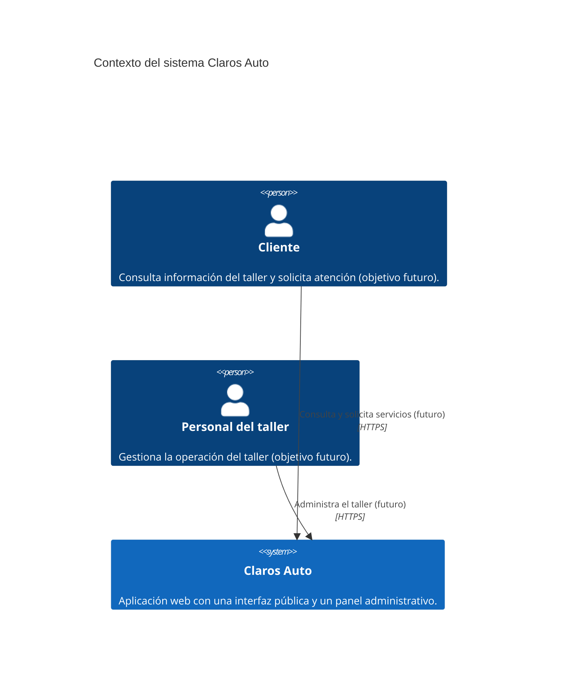

# Arquitectura inicial

Claros Auto se plantea como una aplicación web con una experiencia pública para clientes y un espacio privado para el personal del taller. El cliente podrá consultar información y solicitar atención; el personal podrá administrar la operación del taller.

La aplicación pública implementa las rutas `/`, `/servicios` y `/citas` con React Router. El formulario valida los datos en el navegador y muestra una confirmación de demostración; no envía ni persiste solicitudes. El frontend usa TypeScript, Vite y Tailwind CSS. La API Express con TypeScript expone `GET /api/health`. No existen todavía autenticación, administración ni persistencia. PostgreSQL queda como opción prevista para una fase posterior.

## Diagrama C4 de contexto

El diagrama representa el objetivo del producto. Las interacciones descritas como futuras aún no están disponibles en el software.

## Organización técnica

- `frontend/src/components`: piezas de interfaz reutilizables.
- `frontend/src/data`: datos simulados del catálogo público.
- `frontend/src/pages`: vistas de la aplicación.
- `frontend/src/layouts`: estructura compartida entre vistas.
- `frontend/src/types`: tipos de los modelos del frontend.
- `frontend/src/utils`: validación del formulario de citas.
- `backend/src/routes`: endpoints HTTP.
- `backend/src/middleware`: middleware de Express.
- `backend/src/app.ts`: composición de la aplicación Express, exportada para pruebas.
- `backend/src/server.ts`: lectura de configuración y arranque del servidor.

La configuración de la API se prepara mediante variables de entorno; `PORT` define el puerto de escucha y su valor por defecto es `3000`. La base de datos no está conectada en este avance.
