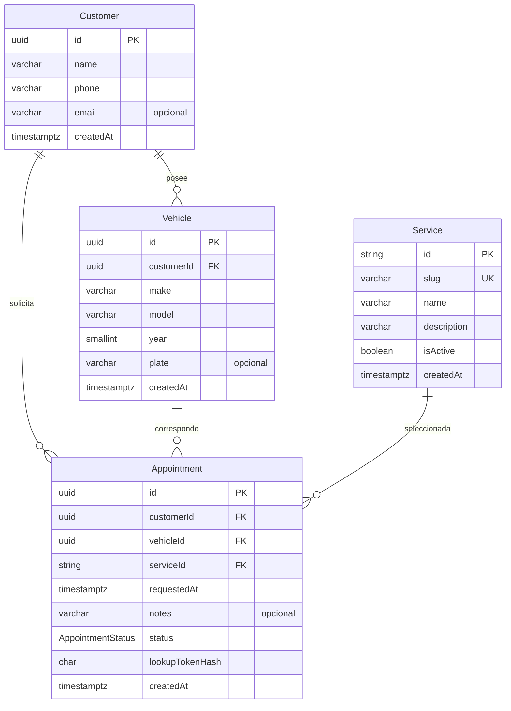

# Arquitectura de Claros Auto

La aplicación separa la interfaz React del backend Express y la persistencia PostgreSQL. El navegador solo comunica con `/api`; las credenciales de PostgreSQL y el cliente Prisma permanecen en el backend.

## Organización técnica

- `frontend/src/components`: formulario de cita, tarjetas de servicio y componentes compartidos.
- `frontend/src/pages`: vistas de inicio, catálogo y citas.
- `frontend/src/services/api.ts`: cliente HTTP que transforma la entrada del formulario al contrato REST.
- `backend/src/config/database.ts`: `pg.Pool`, adaptador Prisma y cliente singleton.
- `backend/src/config/api.ts`: orígenes CORS permitidos.
- `backend/src/modules/servicios`: consulta de servicios activos.
- `backend/src/modules/citas`: validación Zod, rutas, controladores, lógica de token y persistencia.
- `backend/src/middleware/errorHandler.ts`: formato común de errores sin detalles internos.
- `backend/prisma/schema.prisma`: esquema relacional fuente.
- `backend/prisma/migrations`: migraciones versionadas.
- `backend/prisma/seed.ts`: catálogo inicial repetible de servicios.

Express limita el cuerpo JSON a 16 KB. El registro de citas acepta hasta 10 solicitudes por ventana de 15 minutos. CORS permite solo los orígenes declarados en `CORS_ORIGIN` (por defecto, el servidor Vite local). Las rutas de API están organizadas para inyectar dependencias en pruebas HTTP.

## Modelo relacional



`AppointmentStatus` tiene los valores `PENDIENTE`, `CONFIRMADA`, `CANCELADA` y `COMPLETADA`; las citas nuevas siempre comienzan como `PENDIENTE`. Las claves foráneas restringen la eliminación de registros referenciados. Hay índices para teléfonos, relaciones, estado y fecha. El token de consulta sin procesar nunca se guarda; solo su hash SHA-256.

El archivo [modelo-datos.json](modelo-datos.json) representa los mismos modelos, campos, tipos, valores enum y relaciones que `schema.prisma`.

## Endpoints

| Método y ruta        | Función                                                  | Respuesta principal                                |
| -------------------- | -------------------------------------------------------- | -------------------------------------------------- |
| `GET /api/health`    | Verifica que la API está activa. No consulta PostgreSQL. | `200 { status: "ok", service: "claros-auto-api" }` |
| `GET /api/servicios` | Devuelve servicios activos, sin datos privados.          | `200 { data: [...] }`                              |
| `POST /api/citas`    | Valida y guarda una solicitud con estado `PENDIENTE`.    | `201 { data: { id, status, lookupToken, ... } }`   |
| `GET /api/citas/:id` | Devuelve estado, fechas y servicio de una cita.          | `200 { data: ... }`                                |

`GET /api/citas/:id` requiere `Authorization: Bearer <lookupToken>`. Un token faltante o mal formado responde `401`; un token no coincidente devuelve `404` para no confirmar si existe la cita. Ningún endpoint ofrece un listado público de citas. Las respuestas de consulta usan `Cache-Control: no-store`.

## Migraciones y configuración

Define `DATABASE_URL` en `backend/.env` con el URL PostgreSQL proporcionado por la instalación local o el proveedor administrado. No coloques esa variable en el frontend ni en el repositorio. `CORS_ORIGIN` admite una lista separada por comas, y `PORT` controla el puerto del backend.

Para aplicar migraciones versionadas y cargar el catálogo:

```bash
npm --prefix backend run db:migrate:deploy
npm --prefix backend run db:seed
```

Para cambios de esquema durante desarrollo, ejecuta `npm --prefix backend run db:migrate:dev -- --name descripcion`. Antes de producción, revisa el SQL de cada migración y verifica el estado con `db:migrate:status`.

## Verificación y limitaciones

`npm test` ejercita las rutas con Supertest y un repositorio simulado, así que prueba el contrato HTTP sin escribir en una base compartida. `npm --prefix backend run db:validate` valida el esquema y `db:check` verifica la conexión configurada. La suite contra PostgreSQL debe apuntar a una base de pruebas aislada si se incorpora; no se debe ejecutar contra producción.

No se implementan disponibilidad/calendario, confirmación automática, administración, autenticación de empleados ni recuperación del token de consulta. El token se muestra solo en la respuesta de creación y el cliente debe guardarlo por su cuenta si necesita volver a consultar la solicitud.
